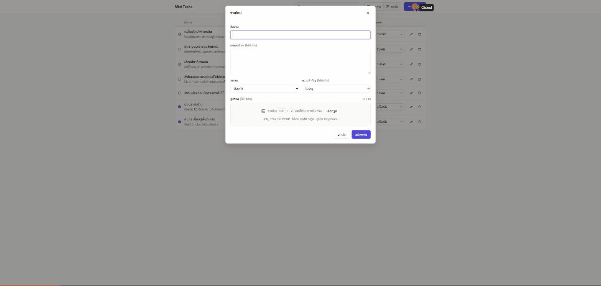
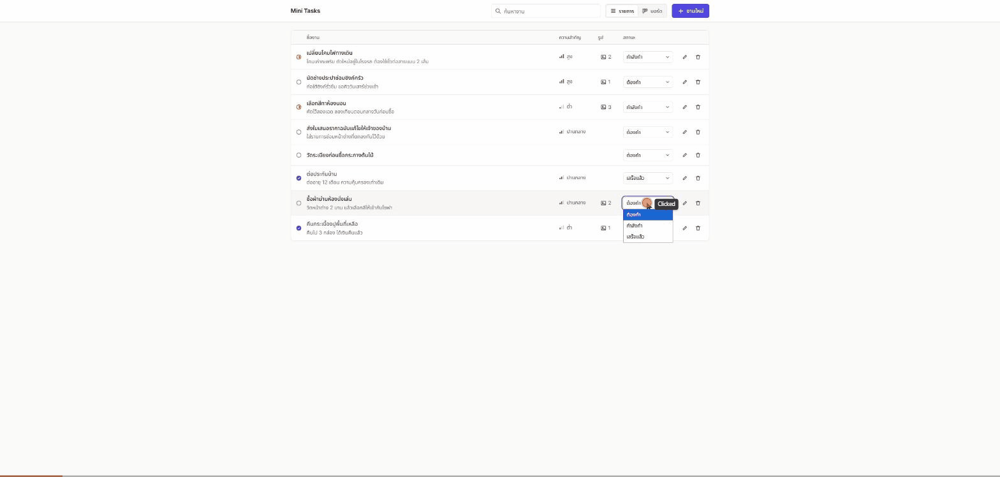
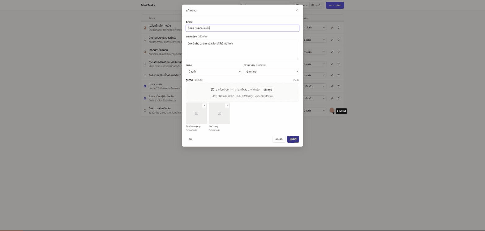

# Mini Tasks

A small shared task list for two people. Google Apps Script web app, data in Google Sheets, images in Google Drive. UI is in Thai.

Features: create / edit / delete tasks, three statuses, List and Board views (drag and drop, plus a status selector on mobile), client-side search, and up to 10 images per task added by Ctrl+V paste, drag and drop or file picker, with previews before upload and a gallery viewer.

## How to use

Recorded on the local preview (`npm run preview`) with sample data.

Full walkthrough with Thai narration and subtitles (1:26): [docs/tutorial/mini-tasks-tutorial.mp4](docs/tutorial/mini-tasks-tutorial.mp4)

1. Create a task with images: **งานใหม่** → title, description, priority → paste, drop or pick images → **สร้างงาน**.

   

2. Change status from the list, search, and move cards on the board. On desktop, cards can also be dragged between columns.

   

3. Open a task to view images full size, edit it, or delete a task (asks for confirmation).

   

## ⚠ Public access

The web app is deployed with **no login**:

- Anyone who has the URL can view, create, edit and delete every task and image. Treat the URL as the only "password".
- Uploaded images are shared as "anyone with the link can view" so the browser can load them from Drive.
- The script runs as the deploying account. Its Drive quota and Sheets are the ones being used.
- There are no user accounts, so there is no audit trail of who changed what.

Do not store anything sensitive. If the URL leaks, create a new deployment and stop the old one.

## Project layout

```text
appsscript.json          Runtime V8, web app: execute as owner, access ANYONE_ANONYMOUS
server/
  Config.gs              Constants: sheet schema, limits, enums
  Utils.gs               AppError, response envelope, write lock, first-run resource creation
  Validation.gs          All input validation (task fields, IDs, image type/size/signature)
  Database.gs            Batch read/append/update/delete over the two sheets
  TaskService.gs         Task CRUD, ordering, optimistic concurrency
  ImageService.gs        Drive upload, removal, image data fallback
  Code.gs                doGet and the public api* functions
  HttpApi.gs             doPost JSON endpoint for the static page
client/
  Index.html             Page shell, includes everything below
  Main.html              Header and main area markup
  components/            Task modal, confirm dialog, lightbox markup
  styles/main.html       All CSS
  scripts/               utils, api, store, toast, image-source, lightbox,
                         confirm-dialog, image-input, task-modal, list-view, board-view, app
tests/                   Node tests with in-memory Apps Script fakes (not deployed)
tools/                   Client syntax check, local preview server, static page build (not deployed)
```

Only top-level functions without a trailing `_` are callable from the browser. Everything else lives inside namespace objects (`Db`, `TaskService`, …) or ends with `_`. A test checks this.

## Data schema

Sheet **Tasks**

| column | type | notes |
| --- | --- | --- |
| task_id | text | `t_<uuid>` |
| title | text | 1–200 chars, required |
| description | text | ≤ 5000 chars |
| status | text | `todo` \| `in_progress` \| `done` |
| priority | text | `low` \| `medium` \| `high` \| empty |
| created_at | number | epoch ms |
| updated_at | number | epoch ms, also the concurrency token |
| position | number | sort order; fractional between neighbours, renumbered when gaps run out |

Sheet **Images**

| column | type | notes |
| --- | --- | --- |
| image_id | text | `i_<uuid>` |
| task_id | text | owning task |
| drive_file_id | text | file in the image folder |
| file_name | text | sanitised original name |
| mime_type | text | `image/jpeg` \| `image/png` \| `image/webp` |
| size_bytes | number | |
| created_at | number | epoch ms |

Timestamps are numbers so Sheets cannot turn them into `Date` values. User text (`title`, `description`, `file_name`) is written with a leading `'` so Sheets keeps it as plain text instead of evaluating formulas or converting `1/2` into a date.

## Server API

All functions return `{ ok: true, data }` or `{ ok: false, error: { code, message } }`. Messages are user-facing Thai. Unknown errors are logged with `console.error` and returned as a generic message.

| function | data |
| --- | --- |
| `apiListTasks()` | `{ tasks }` sorted by position, each with `images` |
| `apiCreateTask(input, requestId)` | `{ task }`. Retrying with the same `requestId` within 10 minutes returns the same task. |
| `apiUpdateTask(taskId, input, expectedUpdatedAt, removeImageIds)` | `{ task }`. Fails with `CONFLICT` if `updated_at` changed. |
| `apiMoveTask(taskId, status, beforeTaskId)` | `{ tasks }`, every task whose position changed |
| `apiDeleteTask(taskId)` | `{ task_id, removed_images }`. Image files go to Drive trash. |
| `apiUploadImage(taskId, { name, mimeType, data })` | `{ image }`. One image per call, base64 data. |
| `apiGetImageData(imageId, 'thumb' \| 'full')` | `{ missing, dataUrl? }`. Only for images registered in the Images sheet. |

Error codes: `VALIDATION`, `NOT_FOUND`, `CONFLICT`, `LIMIT`, `BUSY`, `INTERNAL`.

All writes run inside `LockService.getScriptLock()`, so edits from both people are serialised. The lock is never taken twice in one execution.

## Setup

1. Create a standalone Apps Script project at <https://script.google.com>.
2. Push the code, either:
   - with [clasp](https://github.com/google/clasp): copy `.clasp.json.example` to `.clasp.json`, set `scriptId`, then run `clasp push`; or
   - by hand: create each file under the same path name (for example `server/Code` as a script file, `client/Index` as an HTML file) and paste the contents.
3. In the editor, run `setup` once and accept the permissions. It logs the spreadsheet and folder it will use (see below).
4. Deploy → New deployment → Web app. Execute as: **Me**. Who has access: **Anyone**.
5. Share the `/exec` URL with the other person.

### Host the page outside Google (recommended)

Opening the `/exec` URL directly fails for people signed in to several Google accounts: Google redirects them to `/macros/u/N/exec` and shows "Sorry, unable to open the file at this time". The static page avoids this. It calls `doPost` (`server/HttpApi.gs`) with `fetch` and no Google cookies, so there is no redirect.

```bash
npm run build:static -- --api-url https://script.google.com/macros/s/<deployment-id>/exec
```

Upload `dist/index.html` to any static host and share that link instead of `/exec`. Upload only `dist/`, never the repository (`Config.gs` holds the sheet and folder IDs). The built page contains the `/exec` URL, so anyone with the page can use the API, same as with `/exec` itself.

After changing server code, update the existing deployment so the URL stays the same:

```bash
clasp push
```

```bash
clasp deploy -i <deployment-id> -d "<what changed>"
```

### Spreadsheet and image folder

IDs are resolved in this order:

1. `CONFIG.RESOURCE_IDS` in `server/Config.gs` (set in this repo).
2. Script Properties `SPREADSHEET_ID` / `IMAGE_FOLDER_ID` (names from `CONFIG.PROPERTY_KEYS`).
3. Neither set: a new **Mini Tasks Data** spreadsheet or **Mini Tasks Images** folder is created and its ID saved to Script Properties.

The configured spreadsheet and folder must be owned or editable by the deploying account. The `Tasks` and `Images` sheets are added to the spreadsheet on first use. Other sheets in it are left alone. A sheet already named `Tasks` or `Images` must have the exact headers from the schema above.

The IDs are not secrets, but they do identify your files. Anyone who can read this repository can see them. Access is still controlled by Drive sharing.

## Local development

Requires Node 22+. No dependencies.

```bash
npm test
```

```bash
npm run check
```

```bash
npm run preview
```

- `npm test` runs the server code against in-memory fakes for SpreadsheetApp, DriveApp, LockService, CacheService, PropertiesService and Utilities.
- `npm run check` parses every client script block, separately and combined.
- `npm run preview` serves the real page at <http://localhost:5173> with `google.script.run` routed to the same fakes, seeded with sample tasks. Data resets on restart; `--empty` starts with no tasks.

## Apps Script limitations and unverified behaviour

The fakes model the behaviour this code relies on but cannot prove it. Check these on a real deployment:

- **Quote prefix**: Sheets strips the leading `'` on read. Checked on the real deployment: a task titled `=1+1` shows as `=1+1`.
- **Drive thumbnails**: images load from `drive.google.com/thumbnail?id=…`, which is not a documented API. If it fails, or link sharing is blocked by a Workspace policy, the client falls back to `apiGetImageData`, which sends the bytes through Apps Script. That path is slower and subject to response size limits.
- **Payload size**: each upload sends up to ~10.7 MB of base64 in one `google.script.run` call. The exact limit is not documented. If large images fail, lower `IMAGE_MAX_BYTES` in `Config.gs` and `IMAGE_LIMITS` in `client/scripts/utils.html` together.
- **Quotas**: Apps Script execution time, Drive upload and Sheets quotas apply to the owner account.
- **Locking**: write requests wait up to 20 s for the lock, then fail with `BUSY`.
- **Sync**: the page refreshes every 45 s while visible and when the tab regains focus. There is no push update.

Rate limiting is not authentication. Nothing in this app restricts who can use the URL.
